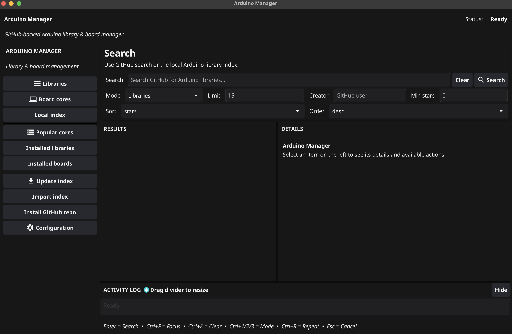

# 🛠 Arduino Manager GUI (Go + Fyne)

<p align="center">
  
</p>

<p align="center">
  <b>Кроссплатформенный менеджер Arduino-библиотек и ядер плат с поиском по GitHub и локальному индексу</b>
</p>

<p align="center">
  
  
  
  
  
</p>

---

## 📌 О проекте

**Arduino Manager GUI** — настольное приложение на **Go + Fyne** для управления библиотеками и ядрами Arduino-плат. Объединяет в одном окне поиск по GitHub и локальному Arduino library index, установку библиотек и ядер, а также журнал операций с возможностью отмены.

Проект демонстрирует полный **CI/CD-цикл** через GitHub Actions: матричную сборку под 4 платформы и публикацию бинарников в **GitHub Releases** по тегу `v*`.

---

## ✨ Возможности

| | Возможность |
|---|---|
| 🔍 | Поиск библиотек и board cores на GitHub |
| 📚 | Поиск по локальному Arduino library index |
| 🎛 | Фильтры: автор, минимальные звёзды, сортировка, лимит |
| 📦 | Установка библиотек: git clone, ZIP-релиз, отдельный тег |
| 🧩 | Установка ядер плат с автоподбором `vendor/arch` |
| ⭐ | Список популярных ядер (ESP8266, ESP32, RP2040, STM32, AVR и др.) |
| 🗑 | Удаление установленных библиотек и ядер |
| ⚙️ | Редактирование конфигурации |
| 📝 | Встроенный activity log |
| ❌ | Отмена активной операции (`Esc`) |
| ⌨️ | Горячие клавиши: `Ctrl+F` / `Ctrl+K` / `Ctrl+1/2/3` / `Ctrl+R` |

---

## 🖼 Скриншот

<p align="center">
  
  <br>
  <em>Главное окно: слева — навигация, сверху — поиск, в центре — результаты, внизу — activity log.</em>
</p>

---

## 🚀 Сборка и запуск

```bash
git clone https://github.com/ChrisRedfield48/arduino-manager-gui.git
cd arduino-manager-gui
go mod tidy
go run .
```

**Linux** требует:

```bash
sudo apt-get install -y libgl1-mesa-dev xorg-dev libxkbcommon-dev
```

**macOS** требует `xcode-select --install`.

---

## 🏗 CI/CD

Workflow запускается по тегу `v*` и собирает бинарники под 4 платформы:

| OS | Arch | Файл |
|---|---|---|
| Linux | amd64 | `ArduinoManager-linux-amd64.tar.gz` |
| Windows | amd64 | `ArduinoManager-windows-amd64.zip` |
| macOS | amd64 | `ArduinoManager-macos-amd64.tar.gz` |
| macOS | arm64 | `ArduinoManager-macos-arm64.tar.gz` |

### Как выпустить релиз

```bash
git tag v1.0.0
git push origin v1.0.0
```

---

## 📄 Лицензия
